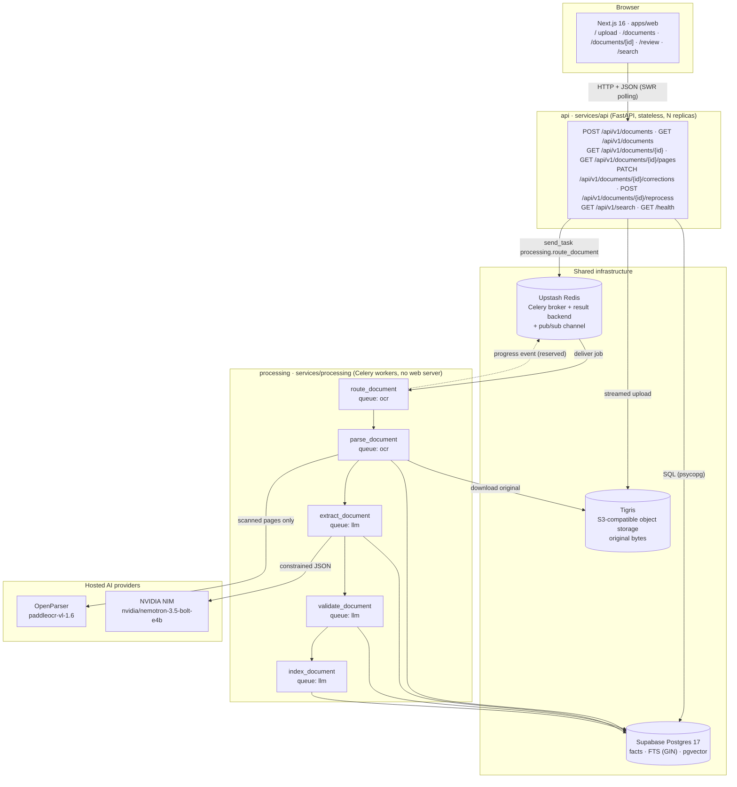
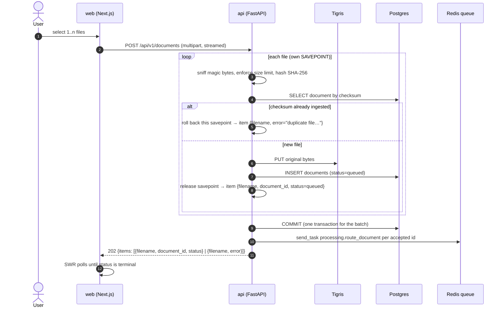
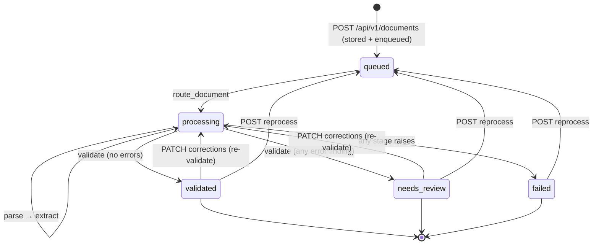
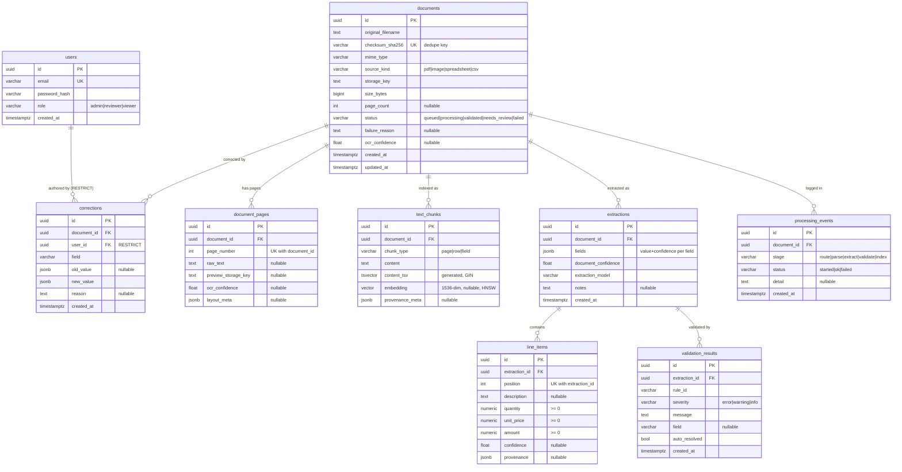

# Architecture & database schema

Diagrams are [Mermaid](https://mermaid.js.org/) — GitHub renders them inline; in an
editor use the Mermaid preview. Everything here describes the **implemented**
system in this repository, not an aspirational design. Design rationale lives in
the project brief (`../ARCHITECTURE.md`, kept outside the repo).

- [1. System architecture](#1-system-architecture)
- [2. Processing pipeline](#2-processing-pipeline)
- [3. Document lifecycle](#3-document-lifecycle)
- [4. Database schema](#4-database-schema)
- [5. Schema reference](#5-schema-reference)

---

## 1. System architecture

Three independently deployable artifacts share one contract package
(`packages/app-core`: models, schemas, settings, storage/LLM/OCR clients,
migrations). There is no Docker; each is a plain process locally and a managed
service in the live setup.



### 1.1 Service boundaries

| Artifact | Directory | Process | Writes | Scaling knob |
|---|---|---|---|---|
| `api` | `services/api` | `uvicorn app.main:app` | `documents` (create + user-triggered status changes) | replicas behind a load balancer |
| `processing` | `services/processing` | `celery -A app.celery_app:celery_app worker -Q ocr,llm` | `documents` (pipeline status, page count), `document_pages`, `extractions`, `line_items`, `validation_results`, `text_chunks`, `processing_events` | worker count per queue (`ocr` is IO-bound on hosted OCR, `llm` on the LLM API) |
| `web` | `apps/web` | `next start` | — (stateless client) | CDN / users, independent of document volume |

Three channels, nothing else:

1. **Queue** — the API enqueues only pipeline entry points: `processing.route_document`
   (queue `ocr`, on upload and reprocess) and `processing.validate_document`
   (queue `llm`, after a correction). It never imports or calls worker code; the
   worker dispatches the rest of the chain itself, so the two services can be
   deployed independently.
2. **Database ownership** — the API writes what a user touches; workers write
   what the pipeline computes. `documents.status` is the single shared column,
   and each writer owns a disjoint set of transitions (API: `queued` on
   reprocess, `processing` on correction; worker: everything else).
3. **Progress** — workers append `processing_events` rows and publish to Redis
   pub/sub (`docintel:events`). The UI **polls** `GET /api/v1/documents/{id}`, which
   returns the event history; no SSE endpoint exists in v1, so the pub/sub
   channel currently has no subscriber and is reserved for it.

The API never touches document bytes after upload: page text is served from
Postgres (`GET /api/v1/documents/{id}/pages` returns pages, or row chunks for
spreadsheets). Page preview images are **not** rendered in v1 — that needs
presigned Tigris URLs, and `presigned_get` in the storage client is currently
unused.

### 1.2 Upload path



The response is a per-file `items` array, and unsupported types, oversized files
and unreadable uploads are reported as `error` items without aborting the batch.
Each file is written inside its own `SAVEPOINT`, so a rejected or failing file
rolls back only its own work and the rest of the batch keeps the rows it already
inserted. Duplicates are caught by a checksum lookup **before** the object upload;
the unique index remains the backstop for concurrent requests, and the
just-uploaded object is deleted if that race is lost.

---

## 2. Processing pipeline

`route_document` is the pipeline entry point for uploads and reprocesses. It
marks the document `processing` and dispatches a Celery chain; each task commits
its own work and appends a `processing_events` row. (Corrections skip the chain
and enqueue `validate_document` directly.)

```mermaid
sequenceDiagram
    autonumber
    participant Q as Redis (ocr / llm)
    participant RT as route_document (ocr)
    participant PA as parse_document (ocr)
    participant EX as extract_document (llm)
    participant VA as validate_document (llm)
    participant IX as index_document (llm)
    participant S as Tigris
    participant O as OpenParser
    participant L as NVIDIA NIM
    participant P as Postgres

    Q->>RT: job(document_id, from_stage)
    RT->>P: documents.status = processing; event(route)
    RT->>Q: chain(parse → extract → validate → index)
    Q->>PA: job(document_id)
    PA->>S: download original
    alt source_kind = pdf and text layer present
        PA->>PA: pdfplumber (no AI)
    else source_kind = image, or scanned pdf
        PA->>O: PaddleOCR-VL
        O-->>PA: pages + confidence
    else spreadsheet / csv
        PA->>PA: pandas / openpyxl (no AI)
    end
    PA->>P: replace document_pages + text_chunks; page_count; event(parse)
    Q->>EX: job(document_id)
    EX->>EX: regex heuristics (always)
    EX->>L: extract all fields (temp 0, JSON schema)
    EX->>P: INSERT extractions + line_items; event(extract)
    Q->>VA: job(document_id)
    VA->>P: DELETE old findings; run 6 rules; INSERT validation_results
    VA->>P: documents.status = validated | needs_review; event(validate)
    Q->>IX: job(document_id)
    IX->>P: verify chunks exist (FTS column already indexed); event(index)
```

**Failure handling.** Any stage exception is caught, recorded as
`documents.status = failed` + `failure_reason` + a `processing_events` row, and
re-raised so Celery marks the task failed and stops the chain. A reprocess
clears the previous failure and restarts from the requested stage.

**Idempotency.** `parse` deletes and rewrites pages/chunks; `extract` appends a
new `extractions` row (readers use the newest by `created_at`); `validate`
deletes and rewrites findings for the extraction it is validating. Re-running any
stage cannot stack duplicates.

**Reprocess vs. correction.**

| Operation | Endpoint | Effect |
|---|---|---|
| Correct a value | `PATCH /api/v1/documents/{id}/corrections` | Stamps the field in `extractions.fields` with `confidence=1.0, source="human"` (optionally replaces all line items), clears stale findings, sets `processing`, enqueues `validate_document` (async re-validation) |
| Reprocess | `POST /api/v1/documents/{id}/reprocess?from=parse\|extract` | Sets `queued` and enqueues `route_document`; `from=extract` skips parsing and keeps the existing pages/chunks. Human-corrected fields are preserved because extraction reads them back from the latest extraction |

---

## 3. Document lifecycle



Terminal-for-the-user states are `validated`, `needs_review` and `failed`; the
first two remain editable. `duplicate_invoice` is a **warning** and never moves a
document to `needs_review` on its own.

---

## 4. Database schema

Nine tables, one migration (`packages/app-core/migrations/versions/0001_*.py`).
Conventions:

- **UUID v4 primary keys**, generated DB-side with `gen_random_uuid()`.
- **Statuses/kinds are plain strings** validated by `StrEnum` in Python **and**
  `CHECK` constraints in Postgres (no Postgres enum types — migrations stay simple).
- **Money is `NUMERIC(12,2)`**; line-item `CHECK`s forbid negative values.
- **Timestamps are `timestamptz`** with DB-side defaults.
- **Foreign keys cascade on delete** down the document graph; `corrections.user_id`
  is `RESTRICT` so audit rows can never be orphaned.
- **Constraint names** are generated by the SQLAlchemy naming convention. Because
  the models also pass a `ck_`-prefixed name, check constraints appear doubled in
  Postgres (e.g. `ck_documents_ck_documents_status_valid`); they are referred to
  here by their readable suffix.



### 4.1 Why these shapes

| Decision | Consequence |
|---|---|
| `extractions.fields` is `JSONB` | The eight header fields evolve without migrations; each entry is `{value, confidence, source, source_span?}`, so confidence travels with the value and `source` distinguishes `heuristic` / `llm` / `human`. |
| Multiple `extractions` per document | Reprocessing is append-only history; readers take the newest row, so nothing is destroyed and diffs are possible. |
| `line_items` are relational | They need arithmetic validation (`line_items_sum`), ordering and per-row confidence — JSONB would push that into application code. |
| `text_chunks.content_tsv` is a **generated** column | `to_tsvector('english', content)` is maintained by Postgres; no trigger, no drift, searchable the moment a chunk is inserted. |
| `embedding` is nullable `vector(1536)` | The `index` stage embeds every chunk; the column stays nullable so a failed embedding run degrades to keyword-only search instead of losing the document. |
| `checksum_sha256` is unique | Uploading the same bytes twice is detected at the DB level, not by a race-prone `SELECT` first. |
| `corrections` is append-only | Designed as the audit trail (old → new, who, why) beside the current value in `extractions.fields`; the table is created but **not written in v1** because no authentication ships yet. |
| `processing_events` is a table, not just pub/sub | Progress survives a Redis restart and a page refresh; the detail screen renders the timeline from it. |

---

## 5. Schema reference

### 5.1 `users`

Created for the auth milestone but **not written in v1** — the API has no login
endpoints yet, and corrections are accepted without an identity.

| Column | Type | Null | Default | Notes |
|---|---|---|---|---|
| `id` | `uuid` | no | `gen_random_uuid()` | PK `pk_users` |
| `email` | `varchar(320)` | no | — | unique `ix_users_email` |
| `password_hash` | `varchar(255)` | no | — | bcrypt/argon hash, never plaintext |
| `role` | `varchar(20)` | no | — | `CHECK` `ck_users_ck_users_role_valid`: `admin`, `reviewer`, `viewer` |
| `created_at` | `timestamptz` | no | `now()` | |

### 5.2 `documents`

| Column | Type | Null | Default | Notes |
|---|---|---|---|---|
| `id` | `uuid` | no | `gen_random_uuid()` | PK |
| `original_filename` | `text` | no | — | as supplied by the client; sanitized only in the storage key |
| `checksum_sha256` | `varchar(64)` | no | — | unique `ix_documents_checksum_sha256` (dedupe) |
| `mime_type` | `varchar(100)` | no | — | from magic bytes, not the extension |
| `source_kind` | `varchar(20)` | no | — | `CHECK`: `pdf`, `image`, `spreadsheet`, `csv` |
| `storage_key` | `text` | no | — | Tigris object key; bytes never live in Postgres |
| `size_bytes` | `bigint` | no | — | enforced against `API_MAX_UPLOAD_MB` |
| `page_count` | `integer` | yes | — | set by `parse` for paged sources |
| `status` | `varchar(20)` | no | `'queued'` | `CHECK`: `queued`, `processing`, `validated`, `needs_review`, `failed`; indexed |
| `failure_reason` | `text` | yes | — | `stage: ExceptionType: message`, truncated |
| `ocr_confidence` | `double precision` | yes | — | reserved; not populated in v1 (per-page confidence lives on `document_pages`) |
| `created_at` | `timestamptz` | no | `now()` | |
| `updated_at` | `timestamptz` | no | `now()` | refreshed on write |

### 5.3 `document_pages`

| Column | Type | Null | Default | Notes |
|---|---|---|---|---|
| `id` | `uuid` | no | `gen_random_uuid()` | PK |
| `document_id` | `uuid` | no | — | FK → `documents.id`, `ON DELETE CASCADE`, indexed |
| `page_number` | `integer` | no | — | `CHECK >= 1`; unique with `document_id` |
| `raw_text` | `text` | yes | — | parsed/OCR text for the page |
| `preview_storage_key` | `text` | yes | — | reserved; previews are not generated or served in v1 |
| `ocr_confidence` | `double precision` | yes | — | per-page mean |
| `layout_meta` | `jsonb` | yes | — | `{width, height}` for digital PDFs, `{ocr_confidence}` for OCR |

### 5.4 `extractions`

| Column | Type | Null | Default | Notes |
|---|---|---|---|---|
| `id` | `uuid` | no | `gen_random_uuid()` | PK |
| `document_id` | `uuid` | no | — | FK → `documents.id` CASCADE, indexed |
| `fields` | `jsonb` | no | — | 8 header fields, each `{value, confidence, source, source_span?}` |
| `document_confidence` | `double precision` | no | — | mean confidence over populated fields |
| `extraction_model` | `varchar(100)` | no | — | `heuristics` (no LLM key) or `heuristics+llm` |
| `notes` | `text` | yes | — | reserved; not written in v1 |
| `created_at` | `timestamptz` | no | `now()` | newest row is authoritative |

`fields` keys: `invoice_number`, `invoice_date` (ISO `YYYY-MM-DD` from the LLM;
heuristic matches are kept verbatim), `supplier_name`,
`customer_name`, `subtotal`, `tax`, `total`, `currency`. An absent value is stored
as `{"value": null, "confidence": 0.0}` — never omitted, never invented.

### 5.5 `line_items`

| Column | Type | Null | Default | Notes |
|---|---|---|---|---|
| `id` | `uuid` | no | `gen_random_uuid()` | PK |
| `extraction_id` | `uuid` | no | — | FK → `extractions.id` CASCADE, indexed |
| `position` | `integer` | no | — | 1-based; unique with `extraction_id` |
| `description` | `text` | yes | — | |
| `quantity` | `numeric(12,2)` | yes | — | `CHECK >= 0` |
| `unit_price` | `numeric(12,2)` | yes | — | `CHECK >= 0` |
| `amount` | `numeric(12,2)` | yes | — | `CHECK >= 0` |
| `confidence` | `double precision` | yes | — | `1.0` when human-entered |
| `provenance` | `jsonb` | yes | — | `{"source": "machine"}` or `{"source": "human"}` |

### 5.6 `validation_results`

| Column | Type | Null | Default | Notes |
|---|---|---|---|---|
| `id` | `uuid` | no | `gen_random_uuid()` | PK |
| `extraction_id` | `uuid` | no | — | FK → `extractions.id` CASCADE, indexed |
| `rule_id` | `varchar(50)` | no | — | one of the six rules below |
| `severity` | `varchar(10)` | no | — | `CHECK`: `error`, `warning`, `info` |
| `message` | `text` | no | — | human-readable, rendered in the review UI |
| `field` | `varchar(50)` | yes | — | offending field, when the rule is field-scoped |
| `auto_resolved` | `boolean` | no | `false` | reserved for future auto-fixes; always `false` in v1 |
| `created_at` | `timestamptz` | no | `now()` | |

| `rule_id` | Severity | Fires when |
|---|---|---|
| `missing_field` | error | a required header field is `null` |
| `type_and_format` | error | `invoice_date` is not ISO-8601, or `subtotal`/`tax`/`total` is not numeric |
| `line_items_sum` | error | `Σ line_items.amount ≠ subtotal` (when both are present) |
| `subtotal_tax_total` | error | `subtotal + tax ≠ total` |
| `negative_or_impossible_values` | error | a line-item `quantity`, `unit_price` or `amount` is negative |
| `duplicate_invoice` | warning | another document has the same `supplier_name` + `invoice_number` |

### 5.7 `processing_events`

| Column | Type | Null | Default | Notes |
|---|---|---|---|---|
| `id` | `uuid` | no | `gen_random_uuid()` | PK |
| `document_id` | `uuid` | no | — | FK → `documents.id` CASCADE, indexed |
| `stage` | `varchar(30)` | no | — | `route`, `parse`, `extract`, `validate`, `index` |
| `status` | `varchar(30)` | no | — | `started`, `ok`, `failed` |
| `detail` | `text` | yes | — | parser name, chunk count, finding count, error |
| `created_at` | `timestamptz` | no | `now()` | timeline order |

### 5.8 `corrections`

Audit-trail table; **not written in v1** (the correction endpoint updates the
extraction in place and relies on `source="human"` for provenance).

| Column | Type | Null | Default | Notes |
|---|---|---|---|---|
| `id` | `uuid` | no | `gen_random_uuid()` | PK |
| `document_id` | `uuid` | no | — | FK → `documents.id` CASCADE, indexed |
| `user_id` | `uuid` | no | — | FK → `users.id` **RESTRICT**, indexed |
| `field` | `varchar(50)` | no | — | header field name or `line_items` |
| `old_value` | `jsonb` | yes | — | previous value object |
| `new_value` | `jsonb` | no | — | corrected value object |
| `reason` | `text` | yes | — | optional reviewer note |
| `created_at` | `timestamptz` | no | `now()` | |

### 5.9 `text_chunks`

| Column | Type | Null | Default | Notes |
|---|---|---|---|---|
| `id` | `uuid` | no | `gen_random_uuid()` | PK |
| `document_id` | `uuid` | no | — | FK → `documents.id` CASCADE, indexed |
| `chunk_type` | `varchar(10)` | no | — | `CHECK`: `page`, `row`, `field` |
| `content` | `text` | no | — | the searchable text |
| `content_tsv` | `tsvector` | yes | generated | `to_tsvector('english', content)`, stored; GIN index |
| `embedding` | `vector(1536)` | yes | — | never written in v1; HNSW `vector_cosine_ops` index |
| `provenance_meta` | `jsonb` | yes | — | `{row, sheet, columns}` for rows; `{width, height}` or `{ocr_confidence}` for pages |

Search runs `content_tsv @@ websearch_to_tsquery('english', q)` and groups hits
per document in Python — one result carrying every matching snippet, ranked by
the best `ts_rank`. Filename `ILIKE` matches join the same result set at a fixed
lower rank. The extraction-derived filters (`supplier`, `min_total`, `currency`)
read the newest extraction per document via `DISTINCT ON (document_id)`.

### 5.10 Indexes

| Index | Table | Definition | Purpose |
|---|---|---|---|
| `pk_*` (9) | all | `PRIMARY KEY (id)` | |
| `ix_users_email` | `users` | `UNIQUE (email)` | login lookup (auth milestone) |
| `ix_documents_checksum_sha256` | `documents` | `UNIQUE (checksum_sha256)` | upload dedupe |
| `ix_documents_status` | `documents` | `(status)` | list filters / review queue |
| `ix_document_pages_document_id` | `document_pages` | `(document_id)` | page fetch |
| `uq_document_pages_doc_page` | `document_pages` | `UNIQUE (document_id, page_number)` | idempotent re-parse |
| `ix_extractions_document_id` | `extractions` | `(document_id)` | newest-extraction lookup |
| `ix_line_items_extraction_id` | `line_items` | `(extraction_id)` | item fetch |
| `uq_line_items_extraction_pos` | `line_items` | `UNIQUE (extraction_id, position)` | stable ordering |
| `ix_validation_results_extraction_id` | `validation_results` | `(extraction_id)` | findings fetch |
| `ix_processing_events_document_id` | `processing_events` | `(document_id)` | timeline fetch |
| `ix_corrections_document_id` | `corrections` | `(document_id)` | audit fetch |
| `ix_corrections_user_id` | `corrections` | `(user_id)` | per-reviewer queries |
| `ix_text_chunks_document_id` | `text_chunks` | `(document_id)` | document-scoped search |
| `ix_text_chunks_fts` | `text_chunks` | `GIN (content_tsv)` | full-text search |
| `ix_text_chunks_embedding` | `text_chunks` | `HNSW (embedding vector_cosine_ops)` | semantic search (nearest-chunk lookup) |

### 5.11 Applying the schema

```bash
cd packages/app-core
set -a && source ../../.env && set +a
uv run alembic upgrade head      # creates the vector extension, 9 tables, FTS column, HNSW index
uv run alembic downgrade base    # drops them in reverse dependency order
```

Migration `0001` is hand-written (not autogenerated) so constraint names, index
methods and the generated column are explicit and reviewable.
